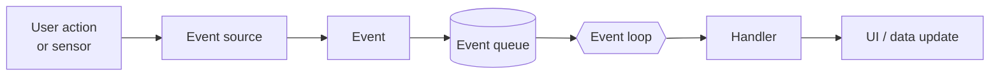

<div align="center">

# ⚡ Event-Driven Programming in Java

**From the event loop to a database-driven JavaFX application, built week by week.**


[Curriculum](#-curriculum) · [Quick Start](#-quick-start) · [Final Project](#-final-project) · [Structure](#-repository-structure) · [Concepts](#-key-concepts)

</div>

---

## 📖 About

This repository is my work for the **Event Programming** unit. Every week is a self-contained folder with
working code, notes and a short README, moving from the theory of events to a complete application.

> **Core idea:** instead of running a fixed script, an event-driven program *waits* and *reacts*.



---

## 🗺️ Curriculum

| Week | Topic | What I built | Status |
|:---:|---|---|:---:|
| 1 | [**Event-Driven Fundamentals**](week01-event-driven-fundamentals) | Components table, event-loop simulation, procedural vs event-driven calculators, 4 bug fixes, Smart Home prototype | ✅ |
| 2 | [**Observer Pattern**](week02-observer-pattern) | Weather station, legacy `Observable` analysis, refactoring tight coupling, `PropertyChangeListener` | ✅ |
| 3 | [**Swing GUI**](week03-swing-gui) | JFrame, components, layout managers, the EDT rule, Student Portal mockup | ✅ |
| 4 | [**Event Handling in Swing**](week04-event-handling) | `ActionListener` styles, `ItemListener`, `DocumentListener`, counter app, registration form, mouse and key | ✅ |
| 5 | [**Advanced Swing Components**](week05-advanced-swing) | `JList`, `JTable`, `JTree`, tabs, menus and dialogs, mini editor, file manager | ✅ |
| 6 | [**Introduction to JavaFX**](week06-javafx) | Stage and Scene, layouts, FXML + Scene Builder, controllers, dashboard | ✅ |
| 7 | [**JavaFX Event Handling**](week07-javafx-events) | Filters vs handlers, mouse and key events, drag and drop, custom events | ✅ |
| 8 | [**Properties and Bindings in JavaFX**](week08-javafx-bindings) | Observable models, listeners, unidirectional and bidirectional bindings, reactive registration form | ✅ |
| 9 | Coming soon | – | ⏳ |
| 10 | [**Final Project: University Management System**](week10-university-system) | JavaFX + MySQL app with background tasks and a scheduled dashboard | ✅ |

```text
Progress  █████████░  90 %
```

## 🎁 Bonus Projects

| Project | Description |
|---|---|
| [Calculator App](./calculator-app) | One calculator built 3 ways: NetBeans, Scene Builder + JavaFX, hand-coded |

---

## 🏆 Final Project

### 🎓 University Management System
> A database-driven, event-driven JavaFX application.

| Learning outcome | How it is applied |
|---|---|
| **EDA principles** | The UI never runs SQL. Only the data layer (`DatabaseUtil`, `StudentRepository`, Tasks) talks to MySQL. |
| **Producer-Consumer** | `LoadStudentsTask` and a save `Task` run on background threads, so the UI never freezes. |
| **Scheduled tasks** | A `ScheduledExecutorService` refreshes the dashboard every 5 seconds. |
| **Event communication** | FXML `onAction` events, property bindings and `Platform.runLater`. |

👉 [Open the project](week10-university-system) · requires JDK 17+, Maven and MySQL.

---

## 🚀 Quick Start

### 1. Clone
```bash
git clone https://github.com/Mohammedismail-cyber/event-driven-programming-java.git
cd event-driven-programming-java
```

### 2. Run a Swing or plain-Java week (Weeks 1 to 5)
```powershell
cd week03-swing-gui\activity1-first-window
javac FirstWindow.java
java FirstWindow
```
Each of these weeks also has a helper script:
```powershell
cd week05-advanced-swing
.\run.ps1 activity5-capstone-file-manager FileManager
```

### 3. Run a JavaFX week (Weeks 6, 7 and 10)
```powershell
cd week07-javafx-events
mvn clean javafx:run "-Djavafx.mainClass=com.example.DragDropDemo"
```

### 4. Run the final project
```powershell
# 1) Create the database: run week10-university-system/database/schema.sql in MySQL Workbench
# 2) Set your password (never stored in the code)
$env:UNI_DB_PASSWORD = "your_mysql_password"
cd week10-university-system
mvn clean javafx:run
```

> ⚠️ Keep the quotes around `-Djavafx.mainClass=...` in PowerShell.

---

## 🧰 Tech Stack

| Area | Tools |
|---|---|
| Language | Java 17+ |
| Desktop UI | Swing, JavaFX 21, FXML, Scene Builder |
| Build | Maven, `javac` |
| Database | MySQL, JDBC |
| Concurrency | EDT, `Thread`, JavaFX `Task`, `ScheduledExecutorService` |
| Tools | VS Code, NetBeans, Git and GitHub |

---

## 📂 Repository Structure

```text
event-driven-programming-java/
├── week01-event-driven-fundamentals/   # theory, bug fixes, prototype
├── week02-observer-pattern/            # Observer from scratch
├── week03-swing-gui/                   # windows, layouts, EDT
├── week04-event-handling/              # listeners, forms, counter
├── week05-advanced-swing/              # tables, trees, file manager
├── week06-javafx/                      # Maven project: Stage, FXML, dashboard
├── week07-javafx-events/               # Maven project: filters, drag and drop
├── week08-javafx-bindings/             # Maven project: JavaFX properties and bindings
├── week10-university-system/           # Maven project: JavaFX + MySQL
├── calculator-app/                     # Calculator built three ways
└── README.md
```

---

## 💡 Key Concepts

<details>
<summary><b>The four parts of an event-driven system</b></summary>

| Part | Meaning | Example |
|---|---|---|
| **Event** | Something that happens | A button click |
| **Source** | Creates the event | `JButton` |
| **Listener** | Waits for the event | `ActionListener` |
| **Handler** | Code that responds | `actionPerformed()` |
</details>

<details>
<summary><b>The two golden rules of GUI threading</b></summary>

1. Create and update the GUI **only** on the UI thread (Swing: the EDT, JavaFX: the JavaFX Application Thread).
2. **Never** run long operations on that thread. Use a background thread (or a JavaFX `Task`) and send the result back with `SwingUtilities.invokeLater` / `Platform.runLater`.
</details>

<details>
<summary><b>Notification mechanisms compared</b></summary>

| Mechanism | Use it for |
|---|---|
| Custom Observer | Plain Java projects |
| `PropertyChangeListener` | JavaBeans and Swing |
| JavaFX properties and bindings | JavaFX apps |
| `java.util.Observable` | ❌ Deprecated, avoid |
</details>

<!--
## 📸 Screenshots
Add screenshots to a /docs folder and show them here, for example:

-->

---

<div align="center">

**Built with ☕ and a lot of events.**

[Mohammedismail-cyber](https://github.com/Mohammedismail-cyber)

</div>
