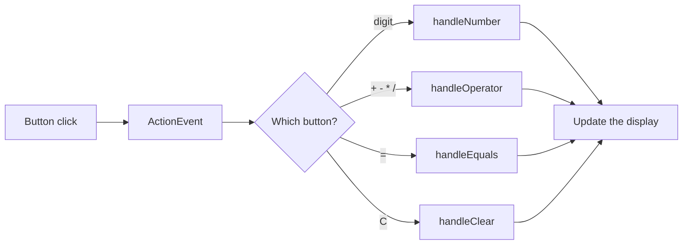

<div align="center">

# 🧮 Calculator App

**One calculator, three ways to build it: NetBeans drag-and-drop, Scene Builder + JavaFX, and fully hand-coded.**


</div>

---

## Why three versions?
VS Code has no built-in drag-and-drop designer for Swing. This project shows the same
event-driven calculator built with each approach, so you can compare them.

| | Option A | Option B | Option C |
|---|---|---|---|
| **Folder** | [`option-a-netbeans-swing`](option-a-netbeans-swing) | [`option-b-javafx-scenebuilder`](option-b-javafx-scenebuilder) | [`option-c-manual-swing`](option-c-manual-swing) |
| **Toolkit** | Swing | JavaFX + FXML | Swing |
| **Designer** | NetBeans Matisse | Scene Builder | None (typed by hand) |
| **Drag and drop?** | ✅ | ✅ | ❌ |
| **Works in VS Code?** | Partly (edit generated code) | ✅ (FXML is plain XML) | ✅ |
| **Event handling** | Generated stubs + shared handlers | FXML `onAction` + controller | Lambda per button |
| **Best for** | Quick Swing prototypes | Modern JavaFX apps | Learning the structure |

## Features
- Digits 0 to 9, the operators `+ - * /` and `=`, and `C` to clear
- Division by zero shows `Error`
- Pressing an operator after `Error` no longer crashes (fixed from the original guide)
- The same logic in every version: `firstOperand`, `operator`, `startNewNumber`

## Run

**Option C: hand-coded Swing**
```powershell
cd option-c-manual-swing
javac -encoding UTF-8 EventDrivenCalculator.java
java EventDrivenCalculator
```

**Option A: NetBeans-style Swing**
```powershell
cd option-a-netbeans-swing
javac -encoding UTF-8 CalculatorFrame.java
java CalculatorFrame
```

**Option B: JavaFX (requires JDK 25 and Maven)**
```powershell
cd option-b-javafx-scenebuilder
mvn clean javafx:run
```

## How the event flow works


## Notes
- Option A is hand-written to match the NetBeans guide. The real `.form` file that
  Matisse creates can only be made inside NetBeans, so the folder also holds
  `handlers-to-paste.txt` and step-by-step instructions for building it visually.
- Recommended order: C (understand it) -> B (drag and drop) -> A (optional).
