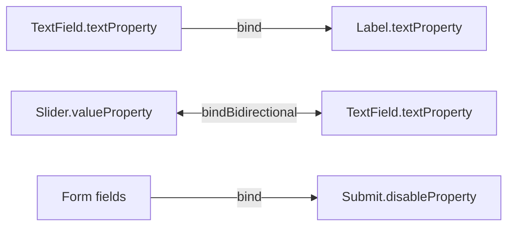

<div align="center">

# 🔗 Week 8 - Properties and Bindings in JavaFX

**Build observable models and reactive UIs that update themselves.**


</div>

---

## 🎯 What this week covers

Instead of writing a listener for every keystroke and button, JavaFX lets you **declare** how values
depend on each other. When the source changes, everything bound to it updates automatically.



## 📦 Activities

| # | Class | Concept | Learning outcome |
|:-:|---|---|:-:|
| 1 | `Person`, `PersonDemo` | Observable model with `StringProperty` and `IntegerProperty` | LO1 |
| 2 | `ListenerDemo` | `InvalidationListener` vs `ChangeListener` | LO2 |
| 3 | `UnidirectionalDemo` | `bind()`: the label follows the text field | LO3 |
| 4 | `BidirectionalDemo` | `bindBidirectional()` with `NumberStringConverter` | LO3 |
| 5 | `ReactiveFormApp` | Capstone: live count, live preview, validation with no click handler | LO4 |

## 🚀 Run

Requirements: **JDK 17+** and **Maven**.

```powershell
mvn clean javafx:run                                    # runs ReactiveFormApp (the capstone)
mvn clean javafx:run "-Djavafx.mainClass=com.example.ListenerDemo"
mvn clean javafx:run "-Djavafx.mainClass=com.example.UnidirectionalDemo"
mvn clean javafx:run "-Djavafx.mainClass=com.example.BidirectionalDemo"
```

Or use the helper script: `.\run.ps1 BidirectionalDemo`

> Keep the quotes around `-Djavafx.mainClass=...` in PowerShell.
> Using a different Java or JavaFX version? Change `maven.compiler.source/target` and the two
> `javafx-*` versions in `pom.xml`.

## ✅ What to check

| Activity | Expected result |
|---|---|
| 1 `PersonDemo` | Console prints each name and age change with old and new values |
| 2 `ListenerDemo` | Alice: both listeners fire. Bob: both fire. Bob again: **nothing** (same value) |
| 3 `UnidirectionalDemo` | Label shows "Hello, Guest", then "Hello, *name*, welcome!" as you type. The button shows the "bound value cannot be set" error |
| 4 `BidirectionalDemo` | Drag the slider and the text changes. Type `20` and the slider jumps |
| 5 `ReactiveFormApp` | Submit is disabled until name and a valid email are filled. Typing over 150 characters disables it again |

## 🛠️ Changes from the original guide

| Guide | This project | Why |
|---|---|---|
| `emailField.textProperty().contains("@")` | `Bindings.createBooleanBinding(...)` | `StringProperty` has no `contains()` method, so the guide's code does **not compile** |
| `ListenerDemo extends Application` with `launch()` | Plain `main` method | It never opened a window, so the program never exited on its own |
| Greeting label showed `, welcome!` for an empty name | `Bindings.when(...).then(...).otherwise(...)` | Shows "Hello, Guest" until a name is typed |
| `.isEmpty()` / `.length()` on the property | `Bindings.isEmpty(...)` / `Bindings.length(...)` | Same behaviour, works on every JavaFX version |
| (none) | `PersonDemo`, error demo button, wrapped preview label | Small extras to see the concepts in action |

## 📚 Key ideas

<details>
<summary><b>InvalidationListener vs ChangeListener</b></summary>

- `InvalidationListener`: "something changed", no values. Cheap, good for triggering a refresh.
- `ChangeListener`: gets the old and new value. Good for undo/redo and logging.
- Setting a property to the **same** value fires neither.
</details>

<details>
<summary><b>bind vs bindBidirectional</b></summary>

- `target.bind(source)`: one way. The target becomes **read-only** (calling `setText` throws an exception until you `unbind()`).
- `a.bindBidirectional(b)`: both ways, either side can be edited. Use a converter when the types differ (text vs number).
</details>

<details>
<summary><b>Why property getters matter</b></summary>

`nameProperty()` returns the property **object**, which is what bindings and listeners attach to.
`getName()` only returns the current value.
</details>

---

<div align="center">

Part of **[Event-Driven Programming in Java](../README.md)**

</div>
