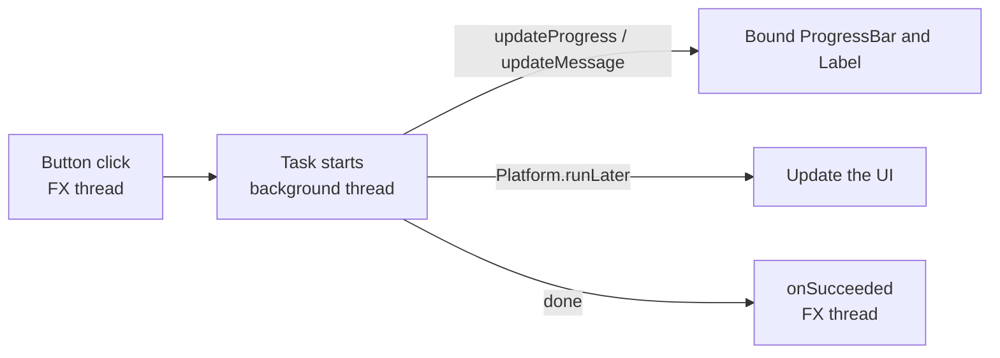

<div align="center">

# ⏱️ Week 9 - Asynchronous Programming in JavaFX

**Keep the UI responsive: run slow work in the background and report progress safely.**


</div>

---

## 🎯 What this week covers

The JavaFX Application Thread draws the screen **and** handles every click. If a handler is slow,
the whole window freezes. The fix is to do the slow work on a background thread and send only the
results back to the UI.



## 📦 Activities

| # | Class | Concept | Learning outcome |
|:-:|---|---|:-:|
| 1 | `FreezeDemo` | **The bad way:** `Thread.sleep` in a handler freezes the window | LO1 |
| 2 | `TaskDemo` | **The fix:** a `Task` on a background thread, safe UI updates | LO2, LO3 |
| 3 | `ProgressDemo` | Live progress with `updateProgress()`, `updateMessage()` and bindings | LO4 |
| 4 | `ServiceDemo` | Capstone: a restartable, cancellable `Service` | LO2, LO3, LO4 |

## 🚀 Run

Requirements: **JDK 17+** and **Maven**.

```powershell
mvn clean javafx:run                                   # runs ServiceDemo (the capstone)
mvn clean javafx:run "-Djavafx.mainClass=com.example.FreezeDemo"
mvn clean javafx:run "-Djavafx.mainClass=com.example.TaskDemo"
mvn clean javafx:run "-Djavafx.mainClass=com.example.ProgressDemo"
```

Or use the helper script: `.\run.ps1 TaskDemo`

> Keep the quotes around `-Djavafx.mainClass=...` in PowerShell.
> Using a different Java or JavaFX version? Change `maven.compiler.source/target` and the two
> `javafx-*` versions in `pom.xml`.

## ✅ What to check

| Activity | Expected result |
|---|---|
| 1 `FreezeDemo` | Click the button: you cannot move or resize the window for 5 seconds. The "Processing..." text never appears |
| 2 `TaskDemo` | The button greys out, the window stays smooth, the label changes to "Halfway there..." then "Task Complete!". The console shows `call()` on a `Thread-` thread and `onSucceeded` on the `JavaFX Application Thread` |
| 3 `ProgressDemo` | The bar fills from 0 to 100 % while the label counts up |
| 4 `ServiceDemo` | Sync shows a spinner and a filling bar. Cancel stops it. Sync again restarts it without problems |

## 🛠️ Changes from the original guide

| Guide | This project | Why |
|---|---|---|
| `startButton.setEnabled(false)` | `startButton.setDisable(true)` | JavaFX buttons have **no** `setEnabled()`; the guide's code did not compile |
| `Platform.runLater()` inside `setOnSucceeded` (and the Self-Check answer saying `setOnSucceeded` runs on the background thread) | Update the UI directly in `setOnSucceeded`; use `Platform.runLater` only inside `call()` | `setOnSucceeded`, `setOnFailed` and `setOnCancelled` already run on the **JavaFX Application Thread**. `Platform.runLater` is needed from `call()` |
| `ProgressDemo` unbinds only on success | Also unbinds on failure | Otherwise a failed task leaves the label bound |
| `ServiceDemo` updated the UI in the Cancel button | Uses `setOnCancelled` | One place handles every way a cancel can happen |
| `call()` returned the success message even after cancel | Returns `null` when cancelled | The result of a cancelled task is ignored anyway |
| `new Thread(task).start()` | Daemon threads | Closing the window does not wait for a running task |
| (none) | Thread-name printouts, progress bar in `ServiceDemo` | See which thread runs what |

## 📚 Key ideas

<details>
<summary><b>Task vs Service</b></summary>

- `Task`: one job, runs **once**. Create a new Task for each run.
- `Service`: creates a fresh Task each time (`createTask()`), so it can be `start()`ed, `restart()`ed and `cancel()`ed again and again.
</details>

<details>
<summary><b>Which thread runs what?</b></summary>

| Code | Thread |
|---|---|
| `Task.call()` | Background thread |
| `setOnSucceeded`, `setOnFailed`, `setOnCancelled` | JavaFX Application Thread |
| `updateProgress()`, `updateMessage()` | Called from the background, delivered to the FX thread |
| `Platform.runLater(...)` | Sends code from the background to the FX thread |
</details>

<details>
<summary><b>Supporting cancellation</b></summary>

Check `isCancelled()` inside `call()` so the work can stop early. `Thread.sleep` also throws
`InterruptedException` when the task is cancelled, which ends the loop.
</details>

---

<div align="center">

Part of **[Event-Driven Programming in Java](../README.md)**

</div>
